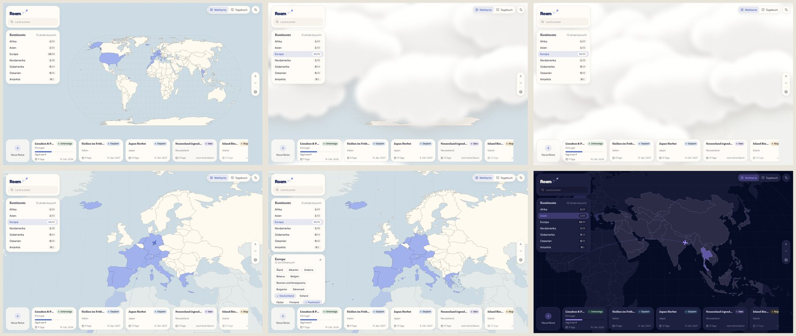
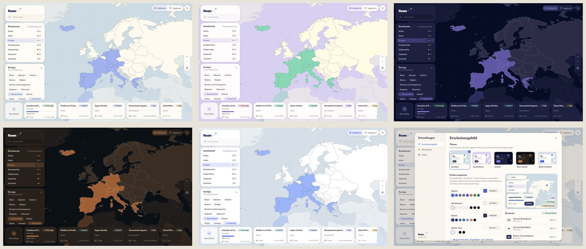

# Roam

Eine ruhige Desktop-App zum Recherchieren, Planen und Träumen von Reisen. Tauri 2 + React + TypeScript, alle Daten lokal in SQLite.





## Stand

| Meilenstein | Inhalt | Status |
| --- | --- | --- |
| 1 | Projektgerüst, SQLite, Design-Tokens, Theme-System mit Presets | ✅ fertig |
| 2 | Weltkarte, Kontinente, Länder, Auswahl-Animation | ✅ fertig |
| 3 | Reise anlegen, Ländertab mit Tabs | offen |
| 4 | Tagesplan mit Zeitblöcken | offen |
| 5 | Budget und Packliste | offen |
| 6 | Galerie und Karte mit Markern | offen |
| 7 | Besuchte Länder, Kontinent-Fortschritt, Auflösungseffekte | offen |
| 8 | Notizen im Word-Stil, Ideen aus früheren Reisen | offen |
| 9 | Flugzeug-Übergang und Pop-Effekte verfeinern | offen |

### Was in Schritt 2 dazukam

- **Weltkarte** im Vollbild mit allen 240 Ländern und Gebieten aus Natural Earth (offline). Besuchte Länder sind eingefärbt, Kleinstaaten erscheinen als Punkte.
- **Kontinent-Übergang** in 1,8 s: Wolken schieben sich herein, die Kamera zoomt darunter, die Wolken treiben weg. Ein Flugzeug fliegt dabei entlang einer gestrichelten Linie, die sich nachzeichnet. Eine neue Auswahl während des Übergangs startet sofort von der aktuellen Position.
- **Panels:** Suche (Länder nach Name, auch „oesterreich“ oder „USA“), Kontinente mit „besucht / gesamt“, Länderchips des gewählten Kontinents, Reisekarten mit Status, Tagen und Fortschritt, Zoom-Steuerung.
- **Länderseite** `/land/:id` als Platzhalter für Schritt 3: Sie rahmt das Land auf der Karte und hat einen Schalter „Schon dort gewesen“ mit Jahr.

### Bedienung der Karte

| Aktion | Maus | Tastatur |
| --- | --- | --- |
| Zoomen | Mausrad, Buttons + / − | `+` / `-` |
| Verschieben | Ziehen | Pfeiltasten |
| Kontinent wählen | Kontinentliste oder Klick auf ein Land | – |
| Land öffnen | Länderchip, Suche, Klick auf ein Land im gewählten Kontinent | Enter in der Suche |
| Zurück | Weltkugel-Button | `Esc` (Länderseite → Karte → ganze Welt) |

### Offene Punkte

- **Reise anlegen** fehlt noch, das kommt in Schritt 3. Bis dahin bleibt die Reiseleiste in einer frischen Installation leer. Im Browser-Vorschaumodus legt `await roamDemo.seed()` in der Konsole Beispieldaten an (nur im Entwicklungsmodus enthalten).
- **Fortschritt** einer Reise ist vorerst: abgeschlossen = 100 %, unterwegs = vergangene Tage / Tage, sonst 0 %. Ab dem Tagesplan (Schritt 4) zählt die geplante Zeit.
- **Performance auf echter Hardware messen:** Im Container ohne GPU läuft der Übergang mit etwa 30 fps, die Karte allein mit 60 fps. Mit Grafikkarte (WebView2, WKWebView) sollte er flüssig sein; geprüft ist das nicht.
- **Ozeanien** rahmt Australien, Neuseeland und Melanesien. Inseln jenseits der Datumsgrenze (Samoa, Tonga, Französisch-Polynesien) liegen am linken Kartenrand und sind über Chips und Suche erreichbar.
- **Zählung:** Natural Earth führt auch abhängige Gebiete (Grönland, Hongkong, Puerto Rico …). Deshalb hat zum Beispiel Afrika 59 statt 54 Einträge. Eine Trennung in Staaten und Gebiete wäre in Schritt 7 möglich.
- **Flug zum Land** (Schritt 3) nutzt dieselben Ebenen, der Pop-Effekt folgt in Schritt 9.

## Starten

Voraussetzungen: Node 22+, Rust (stable) und die [Tauri-Systemabhängigkeiten](https://v2.tauri.app/start/prerequisites/) für dein Betriebssystem.

```bash
npm install
npm run app:dev     # Desktop-App mit Hot Reload
npm run dev         # nur Oberfläche im Browser (Vorschau-Modus, siehe unten)
npm test            # Tests der Datenlogik (Vitest)
npm run typecheck
npm run app:build   # Installer/Bundle für das aktuelle Betriebssystem
npm run icons       # App-Icons aus brand/app-icon.svg neu erzeugen
npm run atlas       # Weltkarte aus Natural Earth neu bauen (src/geo/data/atlas.json)
```

**Windows-`.exe` von Linux aus** (so entstehen die Builds aus dieser Entwicklung): einmalig `rustup target add x86_64-pc-windows-msvc`, `cargo install cargo-xwin`, dazu `nsis`, `lld`, `clang` und `llvm`. Danach:

```bash
npm run app:build:windows
# → src-tauri/target/x86_64-pc-windows-msvc/release/roam.exe                (portabel)
# → src-tauri/target/x86_64-pc-windows-msvc/release/bundle/nsis/*-setup.exe (Installer)
```

Die Dateien sind nicht signiert, Windows warnt deshalb beim ersten Start („Weitere Informationen“ → „Trotzdem ausführen“).

## Aufbau

```
src/
  theme/       Design-Tokens, Presets (JSON), Ableitung, Kontrast, Theme-Store
  db/          SQLite-Adapter, Migrationen, Repositories (settings, themes, countries, trips)
  domain/      reine Logik: Länder pro Kontinent, Zählung, Suche, Reise-Fortschritt
  geo/         Atlas (vorprojizierte Länder), Kontinente und ihre Kartenausschnitte
  data/        Store für Länder und Reisen
  features/map Kamera, Übergangs-Timeline, Wolken, Flugroute, Controller, WorldMap
  motion/      „Bewegung reduzieren“: System + eigener Schalter
  ui/          kleine, theme-neutrale Bausteine (Panel, Button, ColorField, …)
  features/    home, country, settings, journal, map
  brand/       Logo und Flugzeug-Form
  app/         Start, Routing, schwebendes Layout
src-tauri/     Rust-Seite: SQL-Plugin, App-Datenordner, Fenster, CSP
brand/         App-Icon (SVG-Quelle)
scripts/       build-atlas.mjs (Natural Earth → atlas.json)
```

## Entscheidungen

**Tauri statt Electron.** Kleinere Bundles und weniger RAM durch die System-WebView. Dafür rendern drei Engines: WebView2 auf Windows, WebKit auf macOS und WebKitGTK auf Linux. Deshalb nutzt das CSS nichts, was nur Chromium kann, zum Beispiel kein `color-mix()`: Farben werden in TypeScript berechnet.

**Keine View Transitions API.** `document.startViewTransition` lässt WebKitGTK abstürzen (Segfault beim Theme-Wechsel, in der echten Desktop-App nachgestellt). Themes blenden stattdessen per CSS-Transition über (`.theme-fading`).

**SQLite über `tauri-plugin-sql`, Migrationen in TypeScript.** Ein einziger Migrations-Runner (`src/db/migrations.ts`, Versionsstand in `PRAGMA user_version`) läuft in der Desktop-App und in den Tests gegen echtes SQLite. Jede Migration läuft atomar in `BEGIN…COMMIT`. Die Datenbank liegt im App-Datenordner (`roam.db`), daneben `images/` für Bilder. Unter Linux ist das `~/.local/share/app.roam.travel/`.

**Browser-Vorschau mit sql.js.** `npm run dev` im normalen Browser nutzt dasselbe Schema in einem WASM-SQLite und speichert es in IndexedDB. Das ist nur fürs schnelle Entwickeln gedacht, die Desktop-App lädt diesen Code nie.

**Theme-System.**
- Sieben Farbrollen: Hintergrund, Oberfläche, Akzent, Text, Rahmen, Button, Button-Text. Dazu kommen vier dezente Tints für Status-Chips, Bento-Karten und Kategorien.
- Presets sind JSON-Dateien in `src/theme/presets/`, in dieser Reihenfolge: Standard (warmes Off-White), Pastell Bento, Dunkel, Warm dunkel, Weiß mit Akzent.
- Eigene Themes sind genau dieselben JSON-Datensätze, gespeichert in der Tabelle `themes`. `basedOn` merkt sich das Preset für „Zurücksetzen“.
- Alle übrigen Farben werden in `src/theme/derive.ts` abgeleitet: gedämpfter Text, Hover-Töne, Kartenfarben, Schatten. Statische Werte wie Abstände, Radien, Schriften und Bewegung liegen in `src/theme/tokens.ts`.
- Komponenten nutzen nur CSS-Variablen. Ein Test (`single-source.test.ts`) schlägt fehl, sobald außerhalb von `src/theme` eine Farbe hart codiert wird.
- Änderungen im Editor wirken sofort in der ganzen App (Live-Vorschau). Gespeichert wird erst auf Knopfdruck, Presets bleiben schreibgeschützt.
- Wird der Hintergrund von hell auf dunkel (oder umgekehrt) gestellt, passen sich Oberfläche, Text, Rahmen und Tints automatisch an.

**Kontrast.** Die Kontrastprüfung folgt WCAG AA: 4,5 : 1 für Text, 3 : 1 für Akzente. „Anpassen“ verschiebt nur Schrift- oder Akzentfarbe, nie den Hintergrund. Abgeleitete Töne wie gedämpfter Text, Text auf Akzent und Chips auf Tints werden immer lesbar erzeugt, auch bei ungünstigen eigenen Farben.

**Bewegung.** Große Übergänge wie Flug und Zoom dauern 1,8 s, UI-Feedback 140–480 ms. Der Standard folgt „Bewegung reduzieren“ des Systems, in den Einstellungen lässt sich das auf Reduziert oder Voll übersteuern. Reduziert heißt: kurze Überblendungen, kein Flug. Die Dauern stehen als Tokens bereit, für CSS (`--dur-*`) und für Motion (`useDurations`).

**Karte.** SVG mit d3-geo statt MapLibre, aus drei Gründen: Farben kommen direkt aus CSS-Variablen (Live-Vorschau ohne Zusatzaufwand), Flugzeug und gestrichelte Linie sind einfache SVG-Pfade, und die Projektion „Natural Earth“ wirkt ruhiger als Web-Mercator. Für die Detailkarte einer Reise (Meilenstein 6) wird MapLibre neu bewertet.

**Atlas statt Laufzeit-Projektion.**
- `scripts/build-atlas.mjs` nimmt Natural Earth 1:50 Mio. (gemeinfrei, Version 5.1.2), vereinfacht die Formen und projiziert sie einmalig in einen festen Referenzraum (1000 × 520).
- Die App zeichnet die Pfade nie neu. Zoom und Verschieben ändern nur ein `transform` an der Karten-Gruppe, Linien bleiben dank `vector-effect: non-scaling-stroke` gleich dick.
- Die deutschen Namen kommen aus `NAME_DE`, mit ein paar Kurzformen („China“, „Taiwan“). Siachen-Gletscher und Ashmore-Inseln sind keine Reiseziele und fehlen.
- Kleinstaaten, die zu klein zum Anklicken sind, werden zusätzlich als Punkt gezeichnet.
- Der Primärschlüssel eines Landes ist der Natural-Earth-Code (`JPN`), weil nicht jedes Gebiet einen ISO-Code hat (z. B. Nordzypern, Somaliland). `iso_code` ist deshalb optional.

**Kontinent-Ausschnitte von Hand.** Eine berechnete Bounding-Box würde Europa wegen Französisch-Guayana bis nach Südamerika ziehen und Ozeanien über die Datumsgrenze. Deshalb hat jeder Kontinent in `src/geo/continents.ts` einen festen Ausschnitt in Längen- und Breitengraden.

**Kontinent-Übergang.**
- Alle Zeiten und die Wolkenanzahl stehen in einer Konstante: `CONTINENT_TRANSITION` in `src/features/map/transition.ts`.
- Die Timeline ist eine reine Funktion der Zeit. Der `MapController` (ohne React) hält Kamera und laufenden Übergang. Eine neue Auswahl startet aus der aktuellen Kamera und mit der aktuellen Wolkendecke, deshalb springt nichts.
- Getrennte Ebenen von unten nach oben: Karte (SVG-Transform), Flugroute mit Flugzeug, Wolken (CSS-Transforms), Panels.
- Wolken bewegen sich auf demselben Weg hinein und hinaus, damit auch eine Unterbrechung beim Aufklaren nicht ruckelt.
- Die Wolken sind SVG mit Weichzeichner und `feDropShadow` und haben eine dunklere Unterseite für Volumen. Jede Wolke wird einmal als Bild gerendert und danach nur verschoben: Filter in jedem Frame neu zu berechnen hat sich als größte Bremse gemessen.
- Ein Dunstschleier hinter den Wolken schließt die letzten Lücken, sodass die Karte in der Mitte des Übergangs fast ganz bedeckt ist.
- Die gestrichelte Linie zeichnet sich über eine Maske nach, deren durchgezogener Strich per `stroke-dashoffset` wächst. Eine gestrichelte Linie lässt sich mit `stroke-dashoffset` allein nicht aufdecken, weil der Offset dort die Striche verschiebt.
- Bei „Bewegung reduzieren“ blendet die Karte in 360 ms aus und wieder ein, ohne Wolken und Flugzeug.

**Schriften offline.** Alle Schriften sind über Fontsource eingebunden: Fraunces (Überschriften in Standard und den dunklen Themes), Bricolage Grotesque und Plus Jakarta Sans (Pastell Bento, Weiß mit Akzent; Plus Jakarta Sans ist überall die UI-Schrift) sowie Fredoka (Logo).

**Branding.** Der Schriftzug ist in Fredoka gesetzt, mit Flugzeug auf einer gepunkteten Looping-Bahn. Die Logofarben sind fix und hängen nicht vom Theme ab: Nachtblau mit Periwinkle, auf dunklen Themes Creme mit Lavendel. Orange und reines Schwarz kommen nicht vor. Das App-Icon ist eine nachtblaue Kachel mit Flugzeug, Sternen und Planetenbogen (`brand/app-icon.svg`).

**Sprache.** Die Oberfläche ist deutsch, der Code englisch.

## Tests

`npm test` prüft die Datenlogik:
- Farbmathematik und WCAG-Kontrast
- alle Presets lesbar und keine reinen Schwarz- oder Weißtöne als Text
- Ableitung der Tokens und die automatische Kontrastkorrektur
- Validierung der Theme-JSONs
- Migrationen: frisch, idempotent, Rollback bei Fehlern, neuere Schema-Version
- Einstellungen und eigene Themes in SQLite
- der Wächter gegen hart codierte Farben
- ein Preset-Wechsel ändert die angewendeten Token-Werte und wird gespeichert
- Atlas, Länderliste pro Kontinent, Zählung besuchter Länder (in Speicher und SQLite), Suche mit Umlauten und Aliasen
- Seed aller Länder, ohne bereits erfasste Besuche zu überschreiben
- Reisen mit Prüfungen in der Datenbank, Sortierung und Fortschritt
- Kamera-Mathematik, Flugroute und Wolkenpositionen
- Übergangs-Timeline: Wolken, Zoom, Flugzeug, Aufdecken
- Unterbrechung mitten im Flug und beim Aufklaren (die Karte endet auf dem neuen Kontinent), Escape, reduzierte Bewegung

Ab den nächsten Meilensteinen kommen Budgetsummen und Zeitblock-Überschneidungen hinzu.
