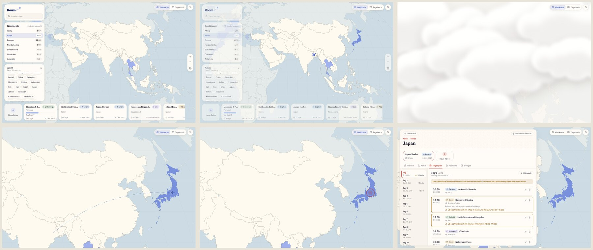
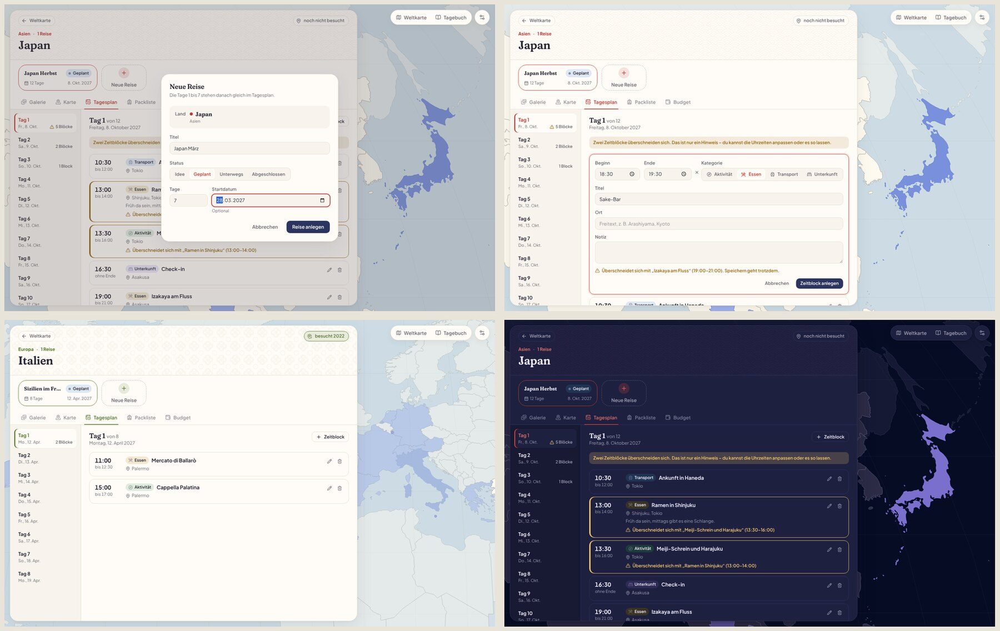

# Roam

Eine ruhige Desktop-App zum Recherchieren, Planen und Träumen von Reisen. Tauri 2 + React + TypeScript, alle Daten lokal in SQLite.





## Stand

| Meilenstein | Inhalt | Status |
| --- | --- | --- |
| 1 | Projektgerüst, SQLite, Design-Tokens, Theme-System mit Presets | ✅ fertig |
| 2 | Weltkarte, Kontinente, Länder, Auswahl-Animation | ✅ fertig |
| 3 | Reise anlegen, Ländertab mit Tabs, Flug zum Land | ✅ fertig |
| 4 | Tagesplan mit Zeitblöcken | 🟡 Grundversion fertig, Ziehen fehlt |
| 5 | Budget und Packliste | offen |
| 6 | Galerie und Karte mit Markern | offen |
| 7 | Besuchte Länder, Kontinent-Fortschritt, Auflösungseffekte | offen |
| 8 | Notizen im Word-Stil, Ideen aus früheren Reisen | offen |
| 9 | Flugzeug-Übergang und Pop-Effekte verfeinern | offen (Grundversion aus Schritt 3 steht) |

**Wiederhergestellt:** Der Code bis Schritt 2.5 lag nur in der damaligen Entwicklungsumgebung und ging mit ihr verloren. Er wurde aus dem Sitzungsverlauf Datei für Datei rekonstruiert und geprüft: an jedem Zwischenstand dieselbe Zahl grüner Tests wie damals (54, 87, 118), ein identischer Atlas, und die App läuft wie zuvor. App-Icons und Screenshots standen als Binärdateien nicht im Verlauf und sind neu erzeugt. Seit Schritt 3 liegt alles in diesem Repository.

### Was in Schritt 3 dazukam

- **Flug zum Land** in 2 s, mit denselben Ebenen wie der Kontinent-Übergang: Das Flugzeug startet in der aktuellen Ansicht und fliegt zum Land, die Wolken verdecken den Wechsel, dann zieht ein Ring im Akzent des Landes auf. Danach öffnet sich die Länderseite. Ein zweiter Klick während des Flugs springt direkt zur Länderseite, `Esc` bricht ab. Bei „Bewegung reduzieren“ gibt es nur eine kurze Überblendung (300 ms).
- **Reise anlegen** in einem Dialog, das Land ist vorgewählt:
  - Der Titel ist mit „Land + Monat“ vorbelegt („Japan März“: Monat des Startdatums, sonst der aktuelle) und folgt dem Datum, bis du ihn selbst änderst.
  - Tage 1–365, vorbelegt sind 7.
  - Status: Idee, geplant, unterwegs oder abgeschlossen.
  - Das Startdatum ist optional. Bei „Idee“ fällt es weg, bei „Unterwegs“ ist es nötig, weil der Fortschritt davon abhängt.
  - Die Tage 1 bis N entstehen sofort und stehen im Tagesplan. Ein Land kann mehrere Reisen haben.
  - Erreichbar über „Neue Reise“ auf der Länderseite oder in der Reiseleiste der Startseite (dann Land über Chip, Suche oder Karte wählen).
- **Reisekarten** zeigen den Status: Idee gestrichelt, geplant normal gerahmt, unterwegs mit Fortschrittsbalken („Tag 4 von 9“), abgeschlossen mit Haken.
- **Ländertab:**
  - Kopf mit Name, Kontinent, Zahl der Reisen und Besuchsstatus („besucht 2022“ oder „noch nicht besucht“, per Klick änderbar).
  - Ein Muster im Kopf mit 5 % Deckkraft (6 % in dunklen Themes). Akzent und Muster kommen aus `src/theme/countries.json`: Japan mit Seigaiha in Rot, Italien mit Majolika-Fliesen in Olivgrün. Länder ohne Eintrag nutzen den Akzent des Themes, ohne Muster.
  - Tabs Galerie, Karte, Tagesplan, Packliste, Budget. Nur der Tagesplan ist echt, die anderen sagen, mit welchem Meilenstein sie kommen.
  - Reise, Tab und Tag stehen in der Adresse (`/land/JPN?reise=…&tab=tagesplan&tag=3`).
- **Tagesplan:**
  - Links die Tage mit Datum, „heute“ und Zahl der Blöcke, rechts die Zeitblöcke des gewählten Tages, nach Uhrzeit sortiert.
  - Felder: Beginn, Ende (optional), Titel, Ort (Freitext), Notiz, Kategorie (Aktivität, Essen, Transport, Unterkunft).
  - Ein neuer Block beginnt dort, wo der letzte endet.
  - Überschneidungen zeigen einen Hinweis an beiden Blöcken, ein Warnzeichen in der Tagesliste und schon im Formular. Gespeichert wird trotzdem.
  - Bearbeiten direkt in der Liste, Löschen mit zweitem Klick („Löschen?“).
  - Verschoben wird über die Uhrzeit, Ziehen kommt später.
- **Daten:** Migration 3 legt `days` und `time_blocks` an, mit Prüfungen für Uhrzeiten und Kategorien direkt in SQLite. Löscht man eine Reise, verschwinden ihre Tage und Blöcke mit. Reisen aus Schritt 2 bekommen ihre Tage beim Update automatisch. Das Repository steht in `src/db/repos/dayPlan.ts`, die Überschneidungsprüfung ist eine reine Funktion in `src/domain/dayPlan.ts`.

### Was in Schritt 2 dazukam


- **Weltkarte** im Vollbild mit allen 240 Ländern und Gebieten aus Natural Earth (offline). Besuchte Länder sind eingefärbt, Kleinstaaten erscheinen als Punkte.
- **Kontinent-Übergang** in 1,8 s: Wolken schieben sich herein, die Kamera zoomt darunter, die Wolken treiben weg. Ein Flugzeug fliegt dabei entlang einer gestrichelten Linie, die sich nachzeichnet. Eine neue Auswahl während des Übergangs startet sofort von der aktuellen Position.
- **Panels:** Suche (Länder nach Name, auch „oesterreich“ oder „USA“), Kontinente mit „besucht / gesamt“, Länderchips des gewählten Kontinents, Reisekarten mit Status, Tagen und Fortschritt, Zoom-Steuerung.
- **Länderseite** `/land/:id` als Platzhalter für Schritt 3: Sie rahmte das Land auf der Karte und hatte einen Schalter „Schon dort gewesen“ mit Jahr.

### Nachtrag zu Schritt 2: flüssige Karte, Themewechsel ohne Lag, Kontrast

- **Zoom und Verschieben:** Mausrad, Trackpad, Ziehen und Tasten setzen nur noch ein Ziel. Eine einzige `requestAnimationFrame`-Schleife führt die Kamera gedämpft dorthin (`src/features/map/follow.ts`). Während der Bewegung rendert React nicht, gesetzt wird nur das `transform` der Kartengruppe.
- **Detailstufen:** Jedes Land liegt grob und fein vor. Gewechselt wird erst, wenn die Karte stillsteht.
- **Land-Zoom** läuft über dieselbe Schleife mit Ease-Kurve. Die Panels aktualisieren sich erst danach.
- **Themewechsel:** Ein einziges Stylesheet am Root-Element, keine Übergänge während des Wechsels, nur der Hintergrund blendet 180 ms. Wolken und Mini-Karten sind CSS-Masken, die Theme-Karten werden nicht neu gerendert.
- **Kartenkontrast:** Land, Meer, Grenze und Hervorhebung sind eigene Tokens pro Preset. Ein Test verlangt mindestens 8 OKLCH-Punkte zwischen Land und Meer und 3 : 1 für Grenzen.

Gemessen im Container ohne GPU bei 1440 × 900 (Bench mit `VITE_ROAM_BENCH=1`, Median aus drei Läufen):

| Messung | Chromium vorher | Chromium nachher | Desktop-App (WebKitGTK) vorher | WebKitGTK nachher |
| --- | --- | --- | --- | --- |
| Mausrad-Zoom | 60 fps, aber nur 16 % der Frames bewegen sich (ruckartig) | 60 fps, 99 % bewegen sich | 57 fps, 16 % bewegen sich | 45 fps, 100 % bewegen sich |
| Trackpad-Zoom | 50 fps | 60 fps | 24 fps | 45 fps |
| Ziehen | 60 fps | 60 fps | 59 fps | 62 fps |
| Land-Zoom | 60 fps | 60 fps | 50 fps | 61 fps |
| Themewechsel, Karte sichtbar | 126 ms | 33 ms | 157 ms | 75 ms |
| Themewechsel aus den Einstellungen | 218 ms | 33 ms | 280 ms | 197 ms |

| Preset | Land/Meer vorher | Land/Meer nachher | Grenze nachher |
| --- | --- | --- | --- |
| Standard | 3,2 Punkte | 10,0 Punkte | 3,8 : 1 |
| Pastell Bento | 2,3 | 11,1 | 3,9 : 1 |
| Dunkel | 9,2 | 14,2 | 3,6 : 1 |
| Warm dunkel | 8,6 | 13,9 | 3,6 : 1 |
| Weiß mit Akzent | 2,4 | 10,1 | 3,7 : 1 |

### Bedienung

| Aktion | Maus | Tastatur |
| --- | --- | --- |
| Zoomen | Mausrad, Buttons + / − | `+` / `-` |
| Verschieben | Ziehen | Pfeiltasten |
| Kontinent wählen | Kontinentliste oder Klick auf ein Land | – |
| Land öffnen | Länderchip, Suche, Klick auf ein Land im gewählten Kontinent | Enter in der Suche |
| Flug überspringen | zweiter Klick während des Flugs | – |
| Flug abbrechen | – | `Esc` |
| Zurück | Weltkugel-Button, „Weltkarte“ auf der Länderseite | `Esc` (Länderseite → Karte → ganze Welt) |
| Tab wechseln | Klick | `←` / `→`, `Pos1` / `Ende` |
| Tag wechseln | Klick in der Tagesliste | `↑` / `↓` in der Tagesliste |
| Zeitblock speichern / verwerfen | Buttons im Formular | `Enter` / `Esc` |

### Offene Punkte

- **Tagesplan:** Zeitblöcke lassen sich noch nicht ziehen, verschoben wird über die Uhrzeit. Ein Block endet spätestens um Mitternacht, eine Nachtfahrt braucht deshalb zwei Blöcke an zwei Tagen.
- **Reise bearbeiten oder löschen** (Titel, Status, Tage, Startdatum) gibt es noch nicht, der Dialog legt nur an. Der Status wechselt auch nicht von selbst, zum Beispiel am Startdatum von „geplant“ zu „unterwegs“.
- **Fortschritt** einer Reise zählt weiter Tage: abgeschlossen = 100 %, unterwegs = vergangene Tage / Tage, sonst 0 %. Ob geplante Zeitblöcke mitzählen sollen, ist offen.
- **Länder-Themes** gibt es bisher für Japan und Italien. Weitere Länder sind ein Eintrag in `src/theme/countries.json` (Akzent und Muster). Neue Muster kommen nach `src/theme/patterns.ts`.
- **Uhrzeit- und Datumsfelder** folgen der Sprache des Systems: Auf einem deutschen Windows steht dort 18:30 und 28.03.2027. Im englischsprachigen Linux-Testcontainer zeigte die Desktop-App AM/PM. Gespeichert wird immer 24-Stunden-Zeit.
- **Demo-Daten:** Im Browser-Vorschaumodus legt `await roamDemo.seed()` in der Konsole Beispielreisen mit Tagesplan an (nur im Entwicklungsmodus enthalten).
- **Performance auf echter Hardware messen:** Im Container ohne GPU läuft der Übergang mit etwa 30 fps, die Karte allein mit 60 fps. Mit Grafikkarte (WebView2, WKWebView) sollte er flüssig sein; geprüft ist das nicht.
- **Themewechsel aus den Einstellungen in der Linux-App:** 197 ms statt der angestrebten 150 ms. WebKitGTK zeichnet dort das große Einstellungsfenster per Software neu, ein einzelner Verursacher war nicht zu finden (die Vorschau ausgeblendet spart etwa 45 ms). Im Browser sind es 33 ms, auf Windows (WebView2 mit GPU) ist es nicht gemessen.
- **Ozeanien** rahmt Australien, Neuseeland und Melanesien. Inseln jenseits der Datumsgrenze (Samoa, Tonga, Französisch-Polynesien) liegen am linken Kartenrand und sind über Chips und Suche erreichbar.
- **Zählung:** Natural Earth führt auch abhängige Gebiete (Grönland, Hongkong, Puerto Rico …). Deshalb hat zum Beispiel Afrika 59 statt 54 Einträge. Eine Trennung in Staaten und Gebiete wäre in Schritt 7 möglich.
- **Pop-Effekt** ist vorerst ein Ring mit weichem Schein. Feinere Effekte folgen in Schritt 9.

## Starten

Voraussetzungen: Node 22+, Rust (stable) und die [Tauri-Systemabhängigkeiten](https://v2.tauri.app/start/prerequisites/) für dein Betriebssystem.

```bash
npm install
npm run app:dev     # Desktop-App mit Hot Reload
npm run dev         # nur Oberfläche im Browser (Vorschau-Modus, siehe unten)
npm test            # Tests der Datenlogik (Vitest)
npm run typecheck
npm run app:build   # Installer/Bundle für das aktuelle Betriebssystem
npm run icons       # App-Icons aus brand/app-icon.svg neu erzeugen
npm run atlas       # Weltkarte aus Natural Earth neu bauen (src/geo/data/atlas.json)
```

**Windows-`.exe` von Linux aus** (so entstehen die Builds aus dieser Entwicklung): einmalig `rustup target add x86_64-pc-windows-msvc`, `cargo install cargo-xwin`, dazu `nsis`, `lld`, `clang` und `llvm`. Danach:

```bash
npm run app:build:windows
# → src-tauri/target/x86_64-pc-windows-msvc/release/roam.exe                (portabel)
# → src-tauri/target/x86_64-pc-windows-msvc/release/bundle/nsis/*-setup.exe (Installer)
```

Die Dateien sind nicht signiert, Windows warnt deshalb beim ersten Start („Weitere Informationen“ → „Trotzdem ausführen“).

## Aufbau

```
src/
  theme/       Design-Tokens, Presets (JSON), Ableitung, Kontrast, Theme-Store,
               Länder-Akzente und Muster (countries.json, patterns.ts, countryTheme.ts)
  db/          SQLite-Adapter, Migrationen, Repositories (settings, themes, countries, trips, dayPlan)
  domain/      reine Logik: Länder pro Kontinent, Zählung, Suche, Reisen (Fortschritt, Prüfung, Titel),
               Tage, Zeitblöcke, Überschneidungen, Sortierung
  geo/         Atlas (vorprojizierte Länder), Kontinente und ihre Kartenausschnitte
  data/        Stores für Länder, Reisen und den Tagesplan
  features/map Kamera, Übergangs-Timeline, Wolken, Flugroute, Pop-Ring, Controller, WorldMap
  motion/      „Bewegung reduzieren“: System + eigener Schalter
  ui/          kleine, theme-neutrale Bausteine (Panel, Button, Dialog, TextField, ColorField, …)
  features/    home, country (Kopf, Muster, Tabs), trips (Karte, Dialog), dayplan, settings, journal, map
  brand/       Logo und Flugzeug-Form
  app/         Start, Routing, schwebendes Layout, Maße der Länderseite
  dev/         Demo-Daten für die Browser-Vorschau (nur im Entwicklungsmodus)
src-tauri/     Rust-Seite: SQL-Plugin, App-Datenordner, Fenster, CSP
brand/         App-Icon (SVG-Quelle)
scripts/       build-atlas.mjs (Natural Earth → atlas.json)
```

## Entscheidungen

**Tauri statt Electron.** Kleinere Bundles und weniger RAM durch die System-WebView. Dafür rendern drei Engines: WebView2 auf Windows, WebKit auf macOS und WebKitGTK auf Linux. Deshalb nutzt das CSS nichts, was nur Chromium kann, zum Beispiel kein `color-mix()`: Farben werden in TypeScript berechnet.

**Keine View Transitions API.** `document.startViewTransition` lässt WebKitGTK abstürzen (Segfault beim Theme-Wechsel, in der echten Desktop-App nachgestellt). Themes blenden stattdessen per CSS-Transition über (`.theme-fading`).

**SQLite über `tauri-plugin-sql`, Migrationen in TypeScript.** Ein einziger Migrations-Runner (`src/db/migrations.ts`, Versionsstand in `PRAGMA user_version`) läuft in der Desktop-App und in den Tests gegen echtes SQLite. Jede Migration läuft atomar in `BEGIN…COMMIT`. Die Datenbank liegt im App-Datenordner (`roam.db`), daneben `images/` für Bilder. Unter Linux ist das `~/.local/share/app.roam.travel/`.

**Browser-Vorschau mit sql.js.** `npm run dev` im normalen Browser nutzt dasselbe Schema in einem WASM-SQLite und speichert es in IndexedDB. Das ist nur fürs schnelle Entwickeln gedacht, die Desktop-App lädt diesen Code nie.

**Theme-System.**


- Sieben Farbrollen: Hintergrund, Oberfläche, Akzent, Text, Rahmen, Button, Button-Text. Dazu kommen vier dezente Tints für Status-Chips, Bento-Karten und Kategorien.
- Presets sind JSON-Dateien in `src/theme/presets/`, in dieser Reihenfolge: Standard (warmes Off-White), Pastell Bento, Dunkel, Warm dunkel, Weiß mit Akzent.
- Eigene Themes sind genau dieselben JSON-Datensätze, gespeichert in der Tabelle `themes`. `basedOn` merkt sich das Preset für „Zurücksetzen“.
- Alle übrigen Farben werden in `src/theme/derive.ts` abgeleitet: gedämpfter Text, Hover-Töne, Kartenfarben, Schatten. Statische Werte wie Abstände, Radien, Schriften und Bewegung liegen in `src/theme/tokens.ts`.
- Komponenten nutzen nur CSS-Variablen. Ein Test (`single-source.test.ts`) schlägt fehl, sobald außerhalb von `src/theme` eine Farbe hart codiert wird.
- Änderungen im Editor wirken sofort in der ganzen App (Live-Vorschau). Gespeichert wird erst auf Knopfdruck, Presets bleiben schreibgeschützt.
- Wird der Hintergrund von hell auf dunkel (oder umgekehrt) gestellt, passen sich Oberfläche, Text, Rahmen und Tints automatisch an.

**Kontrast.** Die Kontrastprüfung folgt WCAG AA: 4,5 : 1 für Text, 3 : 1 für Akzente. „Anpassen“ verschiebt nur Schrift- oder Akzentfarbe, nie den Hintergrund. Abgeleitete Töne wie gedämpfter Text, Text auf Akzent und Chips auf Tints werden immer lesbar erzeugt, auch bei ungünstigen eigenen Farben.

**Bewegung.** Der Kontinent-Übergang dauert 1,8 s, der Flug zum Land 2 s, UI-Feedback 140–480 ms. Der Standard folgt „Bewegung reduzieren“ des Systems, in den Einstellungen lässt sich das auf Reduziert oder Voll übersteuern. Reduziert heißt: kurze Überblendungen, kein Flug. Die Dauern stehen als Tokens bereit, für CSS (`--dur-*`) und für Motion (`useDurations`).

**Karte.** SVG mit d3-geo statt MapLibre, aus drei Gründen: Farben kommen direkt aus CSS-Variablen (Live-Vorschau ohne Zusatzaufwand), Flugzeug und gestrichelte Linie sind einfache SVG-Pfade, und die Projektion „Natural Earth“ wirkt ruhiger als Web-Mercator. Für die Detailkarte einer Reise (Meilenstein 6) wird MapLibre neu bewertet.

**Atlas statt Laufzeit-Projektion.**
- `scripts/build-atlas.mjs` nimmt Natural Earth 1:50 Mio. (gemeinfrei, Version 5.1.2), vereinfacht die Formen und projiziert sie einmalig in einen festen Referenzraum (1000 × 520).
- Die App zeichnet die Pfade nie neu. Zoom und Verschieben ändern nur ein `transform` an der Karten-Gruppe, Linien bleiben dank `vector-effect: non-scaling-stroke` gleich dick.
- Die deutschen Namen kommen aus `NAME_DE`, mit ein paar Kurzformen („China“, „Taiwan“). Siachen-Gletscher und Ashmore-Inseln sind keine Reiseziele und fehlen.
- Kleinstaaten, die zu klein zum Anklicken sind, werden zusätzlich als Punkt gezeichnet.
- Der Primärschlüssel eines Landes ist der Natural-Earth-Code (`JPN`), weil nicht jedes Gebiet einen ISO-Code hat (z. B. Nordzypern, Somaliland). `iso_code` ist deshalb optional.

**Kontinent-Ausschnitte von Hand.** Eine berechnete Bounding-Box würde Europa wegen Französisch-Guayana bis nach Südamerika ziehen und Ozeanien über die Datumsgrenze. Deshalb hat jeder Kontinent in `src/geo/continents.ts` einen festen Ausschnitt in Längen- und Breitengraden.

**Kontinent-Übergang.**
- Alle Zeiten und die Wolkenanzahl stehen in einer Konstante: `CONTINENT_TRANSITION` in `src/features/map/transition.ts`.
- Die Timeline ist eine reine Funktion der Zeit. Der `MapController` (ohne React) hält Kamera und laufenden Übergang. Eine neue Auswahl startet aus der aktuellen Kamera und mit der aktuellen Wolkendecke, deshalb springt nichts.
- Getrennte Ebenen von unten nach oben: Karte (SVG-Transform), Flugroute mit Flugzeug, Wolken (CSS-Transforms), Panels.
- Wolken bewegen sich auf demselben Weg hinein und hinaus, damit auch eine Unterbrechung beim Aufklaren nicht ruckelt.
- Die Wolken sind SVG mit Weichzeichner und `feDropShadow` und haben eine dunklere Unterseite für Volumen. Jede Wolke wird einmal als Bild gerendert und danach nur verschoben: Filter in jedem Frame neu zu berechnen hat sich als größte Bremse gemessen.
- Ein Dunstschleier hinter den Wolken schließt die letzten Lücken, sodass die Karte in der Mitte des Übergangs fast ganz bedeckt ist.
- Die gestrichelte Linie zeichnet sich über eine Maske nach, deren durchgezogener Strich per `stroke-dashoffset` wächst. Eine gestrichelte Linie lässt sich mit `stroke-dashoffset` allein nicht aufdecken, weil der Offset dort die Striche verschiebt.
- Bei „Bewegung reduzieren“ blendet die Karte in 360 ms aus und wieder ein, ohne Wolken und Flugzeug.

**Flug zum Land.**
- Eigene Zeiten in `COUNTRY_TRANSITION` neben `CONTINENT_TRANSITION`, aber dieselbe Timeline-Funktion und dieselben Ebenen. Dazu kommt der Pop-Ring, der ebenfalls nur von der Zeit abhängt.
- Der Flug endet genau im Ausschnitt, den die Länderseite braucht. Die Seite zoomt deshalb nicht ein zweites Mal.
- Die Seite öffnet sich erst, wenn der Controller die Ankunft meldet (`onArrive`). Ein zweiter Klick spult den Flug bis zum Ende vor. Wird währenddessen ein anderes Land gewählt (Suche, Tastatur), landet die App sofort dort.
- Die Panels der Startseite blenden zu Beginn des Flugs aus und nehmen keine Klicks mehr an. So landet jeder Klick bei der Karte und spult den Flug vor.

**Länder-Themes.**
- `src/theme/countries.json` ordnet einem Natural-Earth-Code einen Akzent und ein Muster zu. Die Datei wird beim Start geprüft.
- Die Regeln (`[data-country-theme="JPN"]`) stehen im selben Stylesheet wie das Theme. Ein Themewechsel färbt also auch die Länderakzente im selben Frame um.
- Der Akzent wird pro Theme auf Lesbarkeit geprüft und notfalls in der Helligkeit verschoben, mit 3 : 1 als Akzent und 4,5 : 1 als Text. Der Farbton bleibt dabei erhalten.
- Muster sind SVG-Kacheln mit den Klassen „ground“ und „line“. Die Kacheln selbst enthalten keine Farben, die kommen aus CSS-Variablen.

**Tagesplan-Daten.**
- Uhrzeiten werden als Text „HH:MM“ gespeichert. Das ist sortierbar und wird in SQLite per `GLOB` geprüft. „24:00“ ist als Ende erlaubt und steht für Mitternacht.
- Ein Block mit Ende gilt von Beginn bis Ende. Ein Block, der um 10:00 endet, und einer, der um 10:00 beginnt, überschneiden sich also nicht.
- Ein Block ohne Ende ist ein Zeitpunkt: Er überschneidet sich mit einem Block, in dessen Zeitraum er fällt, und mit einem Zeitpunkt zur gleichen Uhrzeit.
- Überschneidungen werden nicht gespeichert, sondern bei jeder Anzeige mit der reinen Funktion `findOverlaps` berechnet.

**Reise anlegen ohne Transaktion über mehrere Aufrufe.** `tauri-plugin-sql` verteilt Aufrufe auf mehrere Verbindungen. Ein `BEGIN` und das zugehörige `COMMIT` könnten also auf verschiedenen Verbindungen landen. Deshalb wird erst die Reise angelegt, dann alle Tage in einer einzigen Anweisung. Scheitern die Tage, wird die Reise wieder gelöscht.

**Schriften offline.** Alle Schriften sind über Fontsource eingebunden: Fraunces (Überschriften in Standard und den dunklen Themes), Bricolage Grotesque und Plus Jakarta Sans (Pastell Bento, Weiß mit Akzent; Plus Jakarta Sans ist überall die UI-Schrift) sowie Fredoka (Logo).

**Branding.** Der Schriftzug ist in Fredoka gesetzt, mit Flugzeug auf einer gepunkteten Looping-Bahn. Die Logofarben sind fix und hängen nicht vom Theme ab: Nachtblau mit Periwinkle, auf dunklen Themes Creme mit Lavendel. Orange und reines Schwarz kommen nicht vor. Das App-Icon ist eine nachtblaue Kachel mit Flugzeug, Sternen und Planetenbogen (`brand/app-icon.svg`).

**Sprache.** Die Oberfläche ist deutsch, der Code englisch.

## Tests

`npm test` prüft die Datenlogik:
- Farbmathematik und WCAG-Kontrast
- alle Presets lesbar und keine reinen Schwarz- oder Weißtöne als Text
- Ableitung der Tokens und die automatische Kontrastkorrektur
- Validierung der Theme-JSONs
- Migrationen: frisch, idempotent, Rollback bei Fehlern, neuere Schema-Version
- Einstellungen und eigene Themes in SQLite
- der Wächter gegen hart codierte Farben
- ein Preset-Wechsel ändert die angewendeten Token-Werte und wird gespeichert
- Atlas, Länderliste pro Kontinent, Zählung besuchter Länder (in Speicher und SQLite), Suche mit Umlauten und Aliasen
- Seed aller Länder, ohne bereits erfasste Besuche zu überschreiben
- Reisen mit Prüfungen in der Datenbank, Sortierung und Fortschritt
- Kamera-Mathematik, Flugroute und Wolkenpositionen
- Übergangs-Timeline: Wolken, Zoom, Flugzeug, Aufdecken
- Unterbrechung mitten im Flug und beim Aufklaren (die Karte endet auf dem neuen Kontinent), Escape, reduzierte Bewegung
- gedämpftes Folgen endet exakt auf dem Ziel, auch bei Zoom um den Mauszeiger
- ein Themewechsel ändert nur die CSS-Variablen, die Karte rendert dabei nicht neu (jsdom)
- jedes Preset hat zwischen Land und Meer mindestens 8 OKLCH-Punkte und lesbare Grenzen
- Tage einer Reise: Tag 1 bis N, Datum über Monats- und Jahreswechsel, ohne Startdatum undatiert, unbeirrt von Sommerzeit und Schalttag
- Überschneidungen: zwei überlappende Blöcke, zwei angrenzende (10:00 bis 10:00) ohne Warnung, ein Block ohne Ende als Zeitpunkt
- Sortierung nach Beginn, Zeitpunkte vor Zeiträumen, kürzere vor längeren
- Prüfung der Zeitblöcke: Titel, gültige Uhrzeiten, Ende nach Beginn, 00:00 als Mitternacht
- neue Reise: eine Idee ohne Startdatum, „Unterwegs“ braucht eines, Tage 1–365, Titelvorschlag „Land + Monat“
- in SQLite: Reise mit ihren Tagen, mehrere Reisen pro Land, nichts bleibt übrig, wenn eine Reise abgelehnt wird
- Zeitblöcke anlegen, sortieren, ändern und löschen; Überschneidungen werden gemeldet, aber nicht abgelehnt; ungültige Blöcke lehnt auch die Datenbank ab; mit der Reise verschwinden Tage und Blöcke
- Migration 3 ergänzt die Tage für Reisen aus Schritt 2
- Länder-Themes: Japan und Italien vorhanden, Muster zwischen 3 und 6 % Deckkraft, auf jedem Preset lesbar, Teil des Theme-Stylesheets
- Flug zum Land: etwa 2 s mit Flugzeug, Wolken und Ring, endet im Ausschnitt der Länderseite, landet beim zweiten Klick sofort, landet nicht, wenn eine andere Wahl ihn ersetzt, mit reduzierter Bewegung nur Überblendung

Stand: 154 Tests in 12 Dateien. Mit Meilenstein 5 kommen Budgetsummen hinzu.
